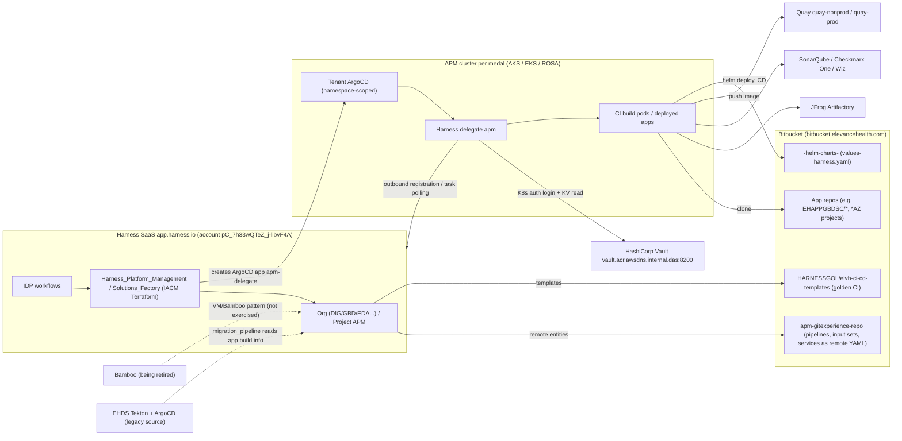
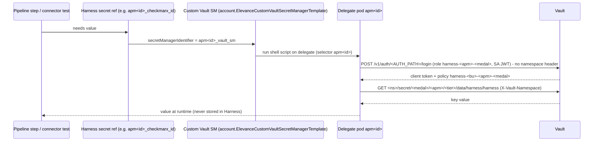
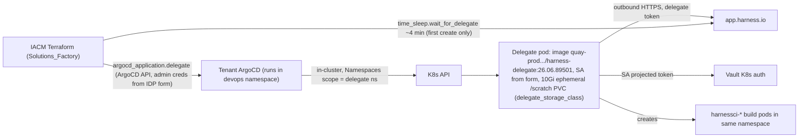
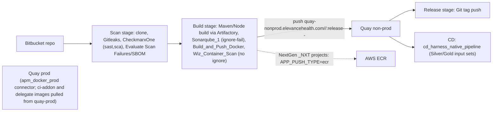
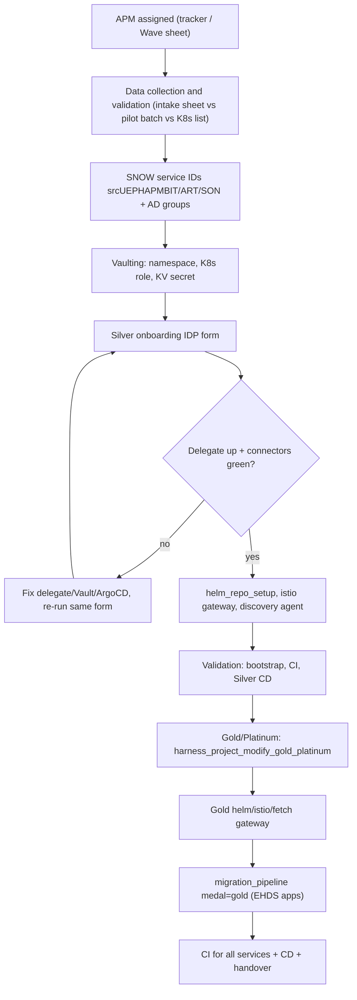
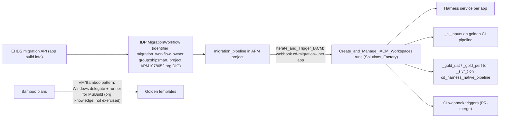

# 03 — Enterprise Architecture

All diagrams show only components seen in our history. Anything not observed is labelled *(proposed/illustrative)*.

## 3.1 High-level architecture

**Arrows explained**
- **IDP → Solutions_Factory → Project**: the IDP form only collects inputs. It triggers `Create_and_Manage_IACM_Workspaces`, which creates or updates an IACM (Terraform) workspace `<ORG>_<project-name>`. Terraform then creates the Harness project and everything in it. [C]
- **Solutions_Factory → ArgoCD → Delegate**: Terraform creates an ArgoCD Application `apm<id>-delegate` (chart `harness-delegate-ng` 1.0.32 from `https://app.harness.io/storage/harness-download/delegate-helm-chart/`, destination `in-cluster`, namespace = delegate namespace, auto-sync, `CreateNamespace`, `ServerSideApply`). ArgoCD deploys the delegate pod. [C]
- **Delegate → Harness**: the delegate registers with selector `apm<id>`. Every connector test, secret decryption and CI pod creation is executed by the delegate. [C]
- **Delegate → Vault**: Kubernetes-auth login with the pod's SA token on `auth/<cluster-auth-path>`, then KV v2 read. [C]
- **CI pods → Bitbucket / Artifactory / scanners / Quay**: the golden CI template's Scan, Build and Release stages. [C]
- **Project → gitexperience repo**: pipelines, input sets and services are stored as **REMOTE** entities in Bitbucket, read and written through the Silver `apm<id>_bitbucket` connector. [C]

## 3.2 Detailed component architecture (one APM, Silver + Gold)

```mermaid
flowchart TB
  subgraph PRJ["Harness project APM<id>"]
    subgraph SLV["Silver connectors"]
      S1["apm<id>_k8s_connector"]
      S2["apm<id>_vault_sm (ns <bu>-<apm>)"]
      S3["apm<id>_vault_sm_bitbucket (ns corp-apm1002184)"]
      S4["apm<id>_bitbucket"]
      S5["apm<id>_docker / apm<id>_docker_prod"]
    end
    subgraph GLD["Gold connectors"]
      G1["apm<id>_gold_k8s_connector"]
      G2["apm<id>_gold_vault_sm"]
      G3["apm<id>_gold_vault_sm_docker"]
      G4["apm<id>_gold_bitbucket"]
      G5["apm<id>_gold_docker"]
    end
    SEC["12 secrets (pointers to Vault)"]
    PIPE["15 pipelines: golden CI x10, cd_harness_native(_dynamic), bootstrap, migration, helm_repo_setup, gateway_setup"]
    ENV["Environments dev/test/prod + 1 infra per namespace"]
    FS["File Store /ci_config (Dockerfiles, settings.xml, pip.conf, .npmrc, certs)"]
    VARS["~110 project variables (namespaces, dnsHost, migration_baseimage_to_pipeline_mapping, SBOM_*...)"]
  end
  DS["Delegate apm<id> (Silver cluster)"] --- S1 & S2 & S3 & S4 & S5
  DG["Delegate apm<id>-gold (Gold cluster)"] --- G1 & G2 & G3 & G4 & G5
  SEC --> S2 & S3 & G2 & G3
```

- Each connector runs on **its own medal's delegate**. A custom Vault SM secret is decrypted on the delegate of the task that consumes it, so a Silver connector cannot use a Gold-SM secret. [C] (seen on APM1081123, 15 Nov)
- Silver `apm<id>_bitbucket` also loads the remote pipelines for **both** medals, so Gold depends on a healthy Silver Bitbucket connector. [C]

## 3.3 Secret-management architecture

Vault location parts (example, DIG Gold): namespace `dig-apm1081520`, KV mount `secret/gld/apm1081520/np02`, path `harness/harness`, keys `artifactory_token` etc. Bitbucket exception: namespace `corp-apm1002184`, path `ldap/us/static-cred/srcueph<apm>bit`. [C]

## 3.4 Delegate communication architecture

See doc 09 for the failure modes at each hop.

## 3.5 Container image staging architecture

Example tag seen: `quay-nonprod…/ehappcsbd/wkstestehappcomjava01:release-master-11172026071936`. [C]
Promotion from non-prod to prod Quay was **never exercised or discussed in detail**. [U]

## 3.6 APM-based workflow architecture

## 3.7 Bamboo/EHDS-to-Harness migration architecture

The onboarding unit is an **input set + trigger against a golden pipeline**, not a per-app pipeline clone. [C] (org knowledge and observed results)
