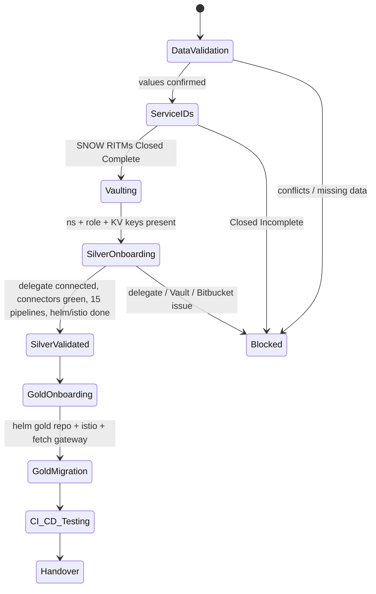

# 07 — APM Execution Workflow

## 7.1 What an APM is here [C]
- The application's ID in the enterprise inventory (ZRM / App Lab), e.g. APM1006894 = Enterprise Auth API.
- **One APM = one Harness project** (identifier = APM ID) in its BU org. An APM contains **many apps/services** (APM1081191 has 166 services across Java, React, Node and Python). It maps to one or more Bitbucket projects (gitexperience + legacy `*SC` + new `*AZ`), one Vault namespace `<bu>-<apm>`, per-medal clusters and namespaces, and per-APM service IDs.
- NextGen is tracked per APM, but apps move one by one into `APM<id>_NXT`. **Your rule**: exclude only `_NXT` services from CI reports and keep the legacy-project services. [C]

## 7.2 Assignment [C]
- Assigned via tracker rows (Wave sheets, "Harness Intake Tracker Wave 2" on SharePoint; Devin couldn't open SharePoint, so sheets were uploaded).
- Your exercise tickets: APM1003706 (UMDE), APM1012135 (DHP), APM1006894 (EAPI), APM1000159 (ACMP), all on ROSA `rosa-np1`.
- Other APMs worked: APM1081191, APM1081670, APM1080718, APM1006991, APM1081123, APM1081216, APM1081520 (reference), APM1010417 (Wave 3), and data validation for 11 Wave 2 APMs (APM1000159, APM1003171, APM1080959, APM1000771, APM1009222, APM1012135, APM1006894, APM1006728, APM1006112, APM1007263, APM1003706).
- Owners on tracker rows (e.g. APM1081191 row "Ashwitha Boddu", "In-Progress – Migration CI/CD Testing Failure").

## 7.3 Information associated with an APM (data sheet rows) [C]
BU / Harness org, Harness project name and ID, description, cluster per medal, Vault auth path, KV mount, Vault namespace, delegate namespace / SA / storage class, ArgoCD server / user / password / project, namespaces + DNS hostnames, Bitbucket Infrastructure Code Project Key, validation repo, Source Code Project key, Quay org, Artifactory project key(s), email DLs, app contacts / IT owner / L3–L5, SNOW tickets (service IDs, AD groups).
Reference sheets: `excel.zip` and `data detail sheets.zip` (41 trackers including `UEP_Wave2_Master_K8s_*.xlsx`, `Harness_PilotBatch_Details.xlsx`, `bulk_137_k8s.xlsx`, `EHDS-Tenant-intake-tracker.xlsx`, `EHDS_Wave1_Gold_Onboarding_Data`, SNOW Master). `argcd-creds*.txt` and the pilot batch hold plain-text passwords: **never echo**.

## 7.4 Lifecycle and dependencies

**Blocking causes seen** [C]: cancelled service-ID tickets (APM1000159, APM1012135: "Closed Incomplete", AD groups "No matches found"), data conflicts between sheets (all 11 Wave 2 APMs; Quay org and Artifactory key missing for all), wrong storage class, OpenShift SCC, Vault role SA binding, wrong Vault namespace, non-existent Bitbucket project key, template bugs (`APPLICATION_NAME`), Bitbucket access for service IDs, shared-token revocation, cluster pod kills.

**Tracking** [C]: tracker status columns; Excel reports (one APM per tab); CI issue analysis workbooks; IDP task links; workspace state.

**Exceptions** [C]: one namespace with many hostnames (one default per namespace; per-app `dnshost` in CD input sets, per Deepak). Two Artifactory keys (one in the form, the rest in File Store `settings.xml`). Shared Bitbucket Vault namespace `corp-apm1002184`. A project ID differing from the sheet (APM1081216 "/ APM1009645" ignored). Namespaces without a hostname excluded (`pega-ud-ai`).

## 7.5 Reusable APM checklist
**A. Before anything**
- [ ] Open the reference sheets; collect every form/vaulting input for this APM; flag conflicts as `value 1 (source) / value 2 (source)`.
- [ ] Check medal status: IACM workspace `argocd_medal_level`, `onboarded_medals`, existing delegates.
- [ ] Confirm BU → Vault namespace `<bu>-<apm>`; confirm cluster/auth path against the onboarded-clusters list (Automation Hub / Postman).
- [ ] Confirm storage class exists on the cluster (`kubectl get storageclass` from the app/platform team), the SA name (ROSA: `argocd-argocd-application-controller`), and that ArgoCD is namespace-scoped (in-cluster Namespaces set).
- [ ] Confirm Bitbucket infra project key exists, and that `apm<id>-gitexperience-repo` exists or can be created with WRITE for `srcUEPHAPM<id>BIT`.
- [ ] One hostname per namespace in `namespace_dns_combinations`; trim spaces.
- [ ] Show the inputs to the lead/your OK before running.

**B. Vaulting**
- [ ] SNOW service IDs (BIT/ART/SON) Closed Complete; AD groups exist.
- [ ] Vault namespace created; K8s role created with the correct ns+SA (`sansPairings`).
- [ ] Tokens minted **as the service ID**; written additively (`--base` / merge-patch). Shared Bitbucket account across medals: mint once and write to both.
- [ ] Checkmarx/Wiz keys into the APM's **own** namespace (ignore the sheet's "vault NS").

**C. Silver onboarding**
- [ ] Submit the IDP form from the UI; record the task link.
- [ ] Monitor: plan → apply → delegate registers within ~4 min → connectors `testConnection` SUCCESS → 15 pipelines → helm (`APPLICATION_NAME` workaround) → istio → DA.
- [ ] On failure, read the plan log (not the "Network operation timed out" label), fix, and re-run the same form.

**D. Validation**
- [ ] Bootstrap once (APM1081520 inputs pattern). Then CI (`<app>_ci_inputs`), then CD per `_slvr_` input set.
- [ ] Report per service; never call IgnoreFailed Success.

**E. Gold/Platinum**
- [ ] `harness_project_modify_gold_platinum` (DIG Gold Docker Vault = per-APM KV, not LDAP).
- [ ] Gold role exists before Gold vaulting; Gold vaulting doesn't revoke Silver tokens.
- [ ] helm gold (correct EXISTING_TENANT / USE_NEW_INFRA_PROJECT) → fetch gateway → istio gold.
- [ ] `migration_pipeline` medal=gold; re-run missing apps in small batches.

**F. Close-out**
- [ ] Revert temporary workarounds (e.g. `SBOM_MAX_RETRYCOUNT` back to 20, connector delegate swaps).
- [ ] Ask for rotation of any exposed credential.
- [ ] Update the tracker; send a per-APM email.
